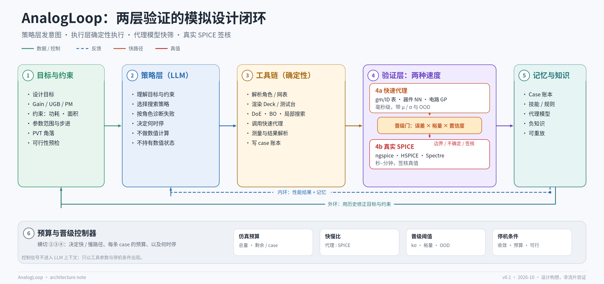

# AnalogLoop

### AI驱动的模拟电路仿真优化Loop架构

让AI根据设计目标和仿真反馈选择下一轮实验，通过ASST执行仿真、汇总指标，再据结果调整策略。项目从个人模拟设计中的ASST工作流实践出发，研究如何把设计意图、仿真执行和结果验证连接成可复现的优化流程。

[](https://github.com/XIAHONGYUU/AnalogLoop/releases) [](LICENSE) [](https://github.com/XIAHONGYUU/AnalogLoop/actions/workflows/validate.yml)

> **当前版本：v1.0.0，架构与接口规范。** 已有文档、原创架构图、结构化示例和校验脚本；优化闭环运行时尚待实现。

[从运放示例看流程](#以两级运放为例) · [查看完整架构](docs/architecture.md) · [ASST经验与执行层设计](docs/asst-and-execution.md) · [规范校验](#查看与校验)

## 先看这个Loop


这是架构中的职责划分：

| 角色 | 负责什么 |
| --- | --- |
| **模拟工程师** | 定义拓扑、目标、可调范围、PVT与测量方法，复核异常并决定是否接受结果 |
| **AI策略层** | 理解目标与反馈、提出下一组实验、分析失败原因，结合剩余预算建议继续或停止 |
| **确定性工具链与ASST执行层** | 校验并落实配置、调用仿真器、提取指标、保存可对比的运行记录 |

策略层通过结构化参数与工具接口提出实验；执行与测量规则负责约束每次运行。AI、脚本和工程师的分工，是这套架构的起点。

## 从实际仿真工作流出发

在个人模拟设计工作中，我主导了ASST网表仿真工作流的需求与架构设计，借助AI实现脚本，并通过实际使用、发现问题和修正持续迭代：

- 用CSV / Excel配置PVT、参数与预设measure，一键生成可重复运行的环境和文件。
- 对接Spectre、ALPS、XA，自动启动仿真、集中处理指标，生成Excel汇总并归档对比。
- 已实际跑通外部AI通过该工作流调用仿真器；ASST本身是执行工具，AI策略由外部提供。

这段实践解决了“如何稳定地执行仿真”。AnalogLoop进一步研究：**下一步该跑什么、如何理解失败、何时值得花费一次真实仿真，以及如何把结果反馈给下一轮决策。**

ASST代码不包含在本仓库中。这里公开的是由这段工程经验形成的架构、接口规范与合成示例。

## 以两级运放为例

已有的[两级运放示例目录](examples/two-stage-opamp/)包含[网表](examples/two-stage-opamp/netlist.cir)、[器件角色](examples/two-stage-opamp/roles.yaml)和[目标规格](examples/two-stage-opamp/spec.yaml)，用于说明输入如何组织。

**以下是架构流程示例，不是一次已运行的优化实验，也不包含实测性能提升。**

| 一轮迭代 | 处理方式 |
| --- | --- |
| 定义任务 | 给出增益、带宽、相位裕度、功耗等目标，以及PVT、面积和可调参数范围 |
| 提出实验 | AI结合当前反馈，提出下一组参数候选及需要运行的分析 |
| 执行与测量 | 工具链检查候选与角色约束，ASST执行层按配置组织仿真并汇总预设指标 |
| 理解失败 | 假设相位裕度未满足目标，先结合负载、补偿与测量上下文分析，再在允许范围内提出补偿参数的调整建议 |
| 反馈与复核 | 将指标、配置与失败原因留在记录中；结合预算决定继续、补充验证或交由工程师复核 |

示例中需要区分的三件事是：**提出候选、运行实验、确认结果**。它们分别有输入、约束和产物，便于工程师检查每一步。

## 三个关键设计

| 设计 | 要解决的工程问题 | 深入阅读 |
| --- | --- | --- |
| **设计意图显式化** | 给器件写明角色、匹配组、比例与可调范围，让参数修改遵守电路结构 | [语义网表](docs/netlist-semantics.md) |
| **快速探索与真实仿真分层** | 用代理模型筛选候选，用真实SPICE复核关键候选和边界情况，并检查代理误接受风险 | [两层验证与晋级门](docs/fast-verification.md) |
| **预算、面积与实验记录进入Loop** | 在迭代中管理仿真成本和面积约束，保留配置、指标与版本以支持重放 | [面积与版图交接](docs/area-and-layout.md) · [预算与停机](docs/budget-and-convergence.md) · [可复原性](docs/reconstructability.md) |

这些是架构设计主张。快速代理、晋级控制和自动优化的运行效果仍需要后续实现与实验验证。

<details>
<summary>展开完整架构图与阅读路径</summary>



- [整体架构](docs/architecture.md)：模块分层、内外回路与失败模式。
- [ASST执行层](docs/asst-and-execution.md)：工程实践背景与执行接口设计。
- [gm/ID与PDK数据库](docs/gm-id-and-pdk-database.md)：快速评估路线及适用范围。
- [记忆与重放](docs/memory-and-replay.md)：case记录、失败知识与重放要求。
- [相关工作](docs/landscape.md)：与已有方法的关系。
- [评审指南](docs/for-reviewers.md)：技术评审问题与规范入口。

</details>

## 当前可以检查什么

| 内容 | 当前状态 |
| --- | --- |
| 架构文档与七张原创图 | 已提供，覆盖策略、执行、两层验证、角色语义、面积和可复原性 |
| 工具接口与数据格式 | 已提供22项工具契约、case schema和manifest schema；工具契约用于描述接口 |
| 两级运放合成示例与校验脚本 | 已提供，可校验数据格式、角色约束、示例一致性及仓库链接 |
| 优化运行时与仿真效果 | mock闭环、真实ASST adapter、ngspice示例、代理模型及优化效果验证待实现 |

[实现路线图](docs/roadmap.md) · [评测协议](docs/benchmark-protocol.md) · [事实、假设与未知](docs/evidence-boundaries.md)

## 查看与校验

想了解设计思路，可以先看上面的流程与运放示例。想检查结构化产物，可以从以下入口开始：

- [工具契约](spec/tool-contract.yaml)
- [case记录schema](spec/case-record.schema.json)与[合成记录示例](examples/sample-case.json)
- [器件角色词表](spec/device-roles.yaml)与[网表manifest schema](spec/netlist-manifest.schema.json)

安装校验脚本所需的`PyYAML`和`jsonschema`后，在仓库根目录运行：

```bash
python scripts/validate.py
```

校验通过说明规范与示例一致，仿真性能仍需独立实验。仓库不包含商业PDK、客户电路或流片数据。

## 许可与版本

文档、图和文字采用[CC BY 4.0](LICENSE)，代码与脚本采用[MIT](LICENSE-CODE)。

[版本记录](CHANGELOG.md) · [引用信息](CITATION.cff) · [v1.0.0原首页](https://github.com/XIAHONGYUU/AnalogLoop/blob/8224866138e5af3d0b410cf8990ff66ee619b4da/README.md)
