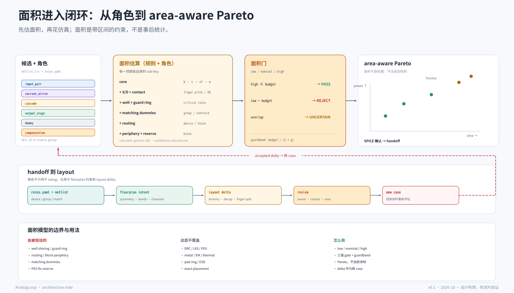

# 面积与 layout handoff



## 1. 为什么面积必须进入闭环

在模拟电路里，面积不是“画完版图再统计”的结果，而是和增益、带宽、噪声、功耗、匹配并列的设计变量：

- 面积影响寄生电容、布线电阻、匹配和良率；
- 面积影响成本，尤其是多通道/阵列电路；
- 不考虑面积的 sizing，会系统性地偏向“更大的管子、更大的电容”，得到一个仿真很好但不可落地的解；
- 等到 layout 才发现面积超了，往往要重新 sizing，前面的仿真预算白花。

所以在 AnalogLoop 里，面积应该是一个**带不确定度的约束/目标**，而不是事后报告。角色标注让这件事变得可行：知道了哪些是输入对、电流镜、cascode、dummy、开关、输出级，就能在画版图之前给出一个可解释的面积区间。

## 2. 能估到什么程度

这里要区分三种“面积”：

| 层级 | 内容 | 用途 | 可信度 |
|---|---|---|---|
| 器件有源区 | W·L·nf·m | 快速排序 | 高（几何） |
| 布局规划面积 | 有源区 + S/D + contact + well + guard ring + dummy + routing + block periphery + reserve | 闭环约束、Pareto | 中（规则） |
| 签核面积 | DRC/LVS/PEX 后的实际版图 | 流片 | 高（但需要 layout） |

本仓库讨论的是**第二层**：pre-layout、rule-based、可追溯的规划面积。它不是 signoff，不能替代 DRC/LVS/PEX，也不能准确覆盖金属/EM、pad ring、thermal、精确 well 共享。

但它足以回答三个问题：

1. 哪个角色/group 主导面积？
2. matching dummy、guard ring、routing、block periphery 增加了多少？
3. 估计的区间有多宽，哪个 rule 产生了这个数？

## 3. 角色如何帮助面积估算

没有角色时，只能把所有管子当成“W·L 的矩形”，会系统性低估：

- 输入对需要 dummy、共质心、guard ring；
- 电流镜需要 unit cell、ratio、dummy；
- cascode 需要 stacked 器件、共享 well、额外的源漏布线；
- 输出级可能需要多 finger、metal/EM 约束；
- 开关是数字/离散的，不能按模拟管连续放大；
- 补偿电容/去耦电容的面积由电容密度决定，不是 W·L；
- ESD 在 pad ring，不属于核心面积。

有了 `roles.yaml`，面积模型可以按角色选择不同的 overhead：

| 角色 | 面积驱动 | 额外开销 |
|---|---|---|
| `input_pair` | W/L、nf、m | dummy、common centroid、guard ring |
| `current_mirror` | ratio、unit cell、dummy | matching overhead、guard ring |
| `cascode` | stacked 器件、well | 共享 well、源漏布线 |
| `output_stage` | W、nf、metal/EM | routing、current density |
| `enable_switch` / `adj_switch` | 小 W | 隔离、dummy、数字布线 |
| `compensation_cap` | 电容密度 | 面积由 C 决定 |
| `decap` | 电容密度 | 通常放 periphery |
| `esd` | pad ring | 不属于核心面积 |

这也是“先有角色，再有面积”的原因：**角色是面积模型的输入，不是面积报告的注释。**

## 4. 一个透明的面积模型

下面是一个简化的、可追溯的模型：

### 4.1 器件

对 MOS：

```text
W_total = W_finger × nf × m
finger_pitch = L + 2·sd_ext + contact_spacing
n_layout_fingers = max(nf·m, ceil(W_total / max_W_per_finger))
W_layout = n_layout_fingers × finger_pitch
H_layout = W_finger + 2·od_ext
A_core = W_layout × H_layout
```

如果角色是 critical（输入对、电流镜、cascode、tail 等），再加 guard ring：

```text
A_ring = 2·(W_layout + H_layout)·ring_width + 4·ring_width²
```

再加 routing overhead：

```text
A_device = (A_core + A_ring) × (1 + routing_overhead)
```

### 4.2 Group

对匹配 group：

```text
A_dummy = avg_device_area × dummy_count × dummy_width_factor
A_group = (Σ A_device + A_dummy) × (1 + matching_overhead)
```

- common centroid：约 12% overhead；
- 普通 matching：约 6%；
- dummy 数量：每个 group 2 个（可配置）。

### 4.3 Block

```text
A_block = (sqrt(Σ A_group) + 2·periphery)² × (1 + block_routing_overhead)
A_low   = A_block × low_factor
A_high  = A_block × high_factor
```

generic-180 教育规则包里，`low_factor = 0.80`、`high_factor = 1.35`。这个区间不是“误差条”，而是**规划阶段的置信区间**：真实版图可能落在里面，也可能因为 well/金属/pad 超出。

所有数值都必须能追溯到一个 rule key（例如 `mos.sd_ext_um`、`matching.common_centroid_overhead`），否则 layout 工程师无法判断这个估算是否可信。

## 5. 面积门：三值判断

面积不能只用“nominal ≤ budget”判断，因为估计本身有区间：

```text
if area_high <= area_budget:      -> PASS
elif area_low > area_budget:      -> REJECT（确定超面积）
else:                             -> UNCERTAIN（需要更准的估计或 layout 复核）
```

对 `UNCERTAIN` 的处理：

- 用更精确的 rule pack / 校准过的模型；
- 让 layout 工程师做一个快速 white-line floorplan；
- 或在 Pareto 里保留，但标记“面积风险”，不直接送签核。

建议优化时留 guardband：

```text
area_target = area_budget / (1 + area_guardband)
```

这样不会把解正好压在 budget 边界上。

注意：`UNCERTAIN` 可能触发一次 layout review，成本是 `human_minute`。预算控制器应把这次 review 计入总成本，而不是当成免费检查。

## 6. 面积不是标量：Pareto，而不是加权和

面积、功耗、速度、噪声经常互相冲突。把面积压成一个加权和，会隐藏“为什么选这个解”。建议：

- 维护一个 Pareto 前沿：面积 vs 功耗 vs UGB/PM（或用户选的两个轴）；
- 报告每个解的 `area_low / nominal / high`、主导角色、距离 budget 的裕量；
- 让策略层选择“在面积约束下最大化性能”或“在性能约束下最小化面积”，而不是替用户决定权重；
- 对 `UNCERTAIN` 的解，单独标记，不混进“可行解”统计。

## 7. 和 layout 工具的接口

面积估算不是终点。一个完整的 handoff 需要三样东西：

1. **面积报告**：`area_report`，含 low/nominal/high、by_role、dominant groups、warnings、rule pack 版本；
2. **floorplan intent**：white-line 的相对 placement、symmetry、matching group、routing channel、dummy/decap reservation；
3. **layout delta**：边界 dummy、decap、finger split、guard ring 等“可预见的小改动”，每条带 area impact、owner、reason、status。

### 7.1 输入方式

面积工具可以读 `netlist.cir + roles.yaml`，也可以接受 `role= / match= / group=` 作为导出格式。manifest 是唯一事实，inline 只是导出格式。

推荐的工具接口：

```yaml
- name: estimate_area
  input: {candidate_id, rule_pack?}
  output: {area_low_um2, area_nominal_um2, area_high_um2, by_role, rules, warnings}

- name: export_layout_intent
  input: {candidate_id}
  output: {floorplan_sha256, delta_sha256, area_report_sha256}
```

流程：

```text
candidate + roles.yaml
  -> estimate_area
  -> area gate（PASS / REJECT / UNCERTAIN）
  -> area-aware Pareto
  -> SPICE 确认
  -> export_layout_intent（floorplan + delta）
  -> layout review
  -> 接受的 delta 作为新 case 回到闭环
```

关键原则：**layout delta 不是静默的 PEX 修补，而是显式的新 case。** 它可能改变面积、寄生、匹配，必须重新评估，而不是在版图阶段偷偷改掉。

## 8. 误差与校准

面积模型的价值取决于校准，而不是公式有多复杂。

建议：

- 用 3–5 个已经完成的 layout 做校准；
- 报告误差分布（median、p95、max），不只报平均；
- 报告 rank correlation（至少能正确排序“谁更大”）；
- 报告 `area_low ≤ actual ≤ area_high` 的覆盖率；
- 每次 rule pack / PDK 变更，跑固定回归集；
- 把 `area_model_sha256` 和 `rules_name` 写进 case 记录。

不要在没有校准的情况下宣称“95% 准确”。面积模型和代理模型一样：**区间 + 置信度 + 可追溯**，比一个漂亮的单点数字更有用。

## 9. 可证伪假设 H5

**H5：与“只看 W·L”相比，角色感知的面积模型能更早识别面积超限，减少后期 layout 返工和面积 surprise。**

可做的 ablation：

| 配置 | 说明 |
|---|---|
| A. 只算 W·L | 无 dummy/guard ring/routing/periphery |
| B. 器件级 | 加 S/D、contact、well、routing |
| C. 角色 + group | 加 dummy、matching、guard ring |
| D. C + block/periphery + 校准 | 本仓库方案 |

指标：

- 与真实 layout 的面积误差（median / p95）；
- rank correlation；
- 面积超限的早期发现率；
- layout delta 数量；
- 返工次数；
- 面积约束下的 Pareto 质量。

当前状态：**未测**。

## 10. 与现有工作的关系

模拟版图自动化（ALIGN、BAG、MAGICAL 等）关注的是从网表/约束生成可制造版图；面积估算通常是其中的一个子步骤。本仓库不重复做 P&R，而是把面积作为**sizing 闭环的约束**，并把角色、面积报告、floorplan intent、layout delta 串成一个可审计的 handoff。

面积模型与具体 layout 工具解耦；本仓库只定义接口和验收口径。

## 11. 局限

- **rule pack 是教育用的**：generic-180 不是 PDK，不能用于 signoff；
- **well / guard ring / routing 是近似**：真实版图可能因 sharing、DRC、metal 密度而变化；
- **金属/EM/thermal/pad ring** 没有完整覆盖；
- **层次化与多 finger**：需要 `nf`、`m`、`unit_count` 和 subckt 展平；
- **电容密度** 依赖具体器件（MIM/MOM/MOS cap），generic 规则只能给数量级；
- **没有 DRC/LVS/PEX**：这是 layout 阶段的职责，不是本层的承诺。

## 12. 一句话

**先估面积，再花仿真；面积是带区间的约束，不是事后统计。** 角色让面积可估，validator 让角色可信，area gate 让估算进入决策，layout delta 让修改可审计。
