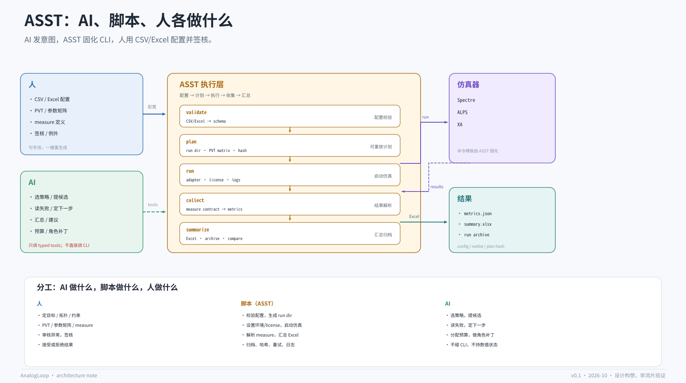

# ASST：把仿真器 CLI 固化成一个可被 AI 调用的执行层



> 这一页描述作者此前的 ASST 工作流，用于说明“AI 如何调用仿真器”这一层该怎么设计。
> ASST 的代码不在本仓库；这里记录的是接口、分工和可复现性要求，不宣称性能数字。

## 1. 问题：AI 直接调仿真器 CLI，为什么不好用

“AI 可以调用仿真器”听起来很直接：给模型一个 shell，让它拼 Spectre/ALPS/XA 的命令。但真实使用时会遇到：

- **CLI 不统一**：Spectre、ALPS、XA 的参数、环境变量、license、输出格式都不同；
- **容易幻觉**：模型会编造 flag、路径、analysis 名称；
- **不可复现**：同一个“想法”每次生成的命令、目录、netlist 可能不同；
- **人类习惯不同**：同事有自己的脚本和配置方式，不能被一个 agent 强行统一；
- **结果分散**：raw 文件、log、measure 结果散落在不同目录，难以对比；
- **审计困难**：事后无法回答“这次仿真到底用了哪个配置、哪个版本、哪个 corner”。

所以需要一层**稳定的执行接口**：AI 不直接碰 CLI，脚本把命令、环境、目录、结果解析固化下来，人用熟悉的表格配置。

这就是 ASST 的位置。

## 2. ASST 是什么

ASST 是作者此前为个人模拟设计开发的**网表仿真工作流**：

- 对接 **Spectre、ALPS、XA**；
- 支持 **AI 调用**，也支持 **CSV / Excel 表格配置**；
- 一键生成可重复运行的仿真环境与文件；
- 按 **PVT** 和参数配置自动启动仿真；
- 集中处理预设 **measure** 指标；
- 生成 **Excel 汇总**并归档，方便结果对比。

一句话：**ASST 把“怎么跑仿真”固化下来，让 AI 和人都通过同一个稳定接口使用仿真器。**

## 3. 三层分工：AI、脚本、人

这是整个工作流最重要的部分。

| 角色 | 做什么 | 不做什么 |
|---|---|---|
| **人** | 定目标、拓扑、约束、PVT/参数矩阵、measure 定义；审核异常；签核；决定接受/拒绝 | 不手写重复的仿真脚本；不逐条拼 CLI |
| **脚本（ASST）** | 校验配置；生成 run dir、netlist/testbench、命令脚本；设置环境/license/queue；启动仿真；解析 measure；汇总 Excel；归档；记录哈希 | 不决定“下一步试什么”；不改设计意图；不做策略判断 |
| **AI** | 选策略；提候选；读失败；决定下一组实验；分配预算；做角色级补丁；汇总建议 | 不直接调 CLI；不持有数值状态；不绕过配置/测量契约 |

用 MCU 类比：

- **AI = CPU**：决定“做什么”；
- **ASST = HAL + 外设驱动 + 固件**：把意图翻译成具体时序/命令；
- **人 = 板级设计者/签核者**：定义目标、约束和验收；
- **仿真器 = 硬件计算单元**：给真值。

## 4. 架构：配置 → 计划 → 执行 → 收集 → 汇总

### 4.0 单一真相源：一张 CSV/Excel 为什么能防止跑偏

ASST 的真正价值，不只是“包一层 CLI”，而是把散落在脚本、聊天、日志、临时目录里的真相，收拢到**一张可版本化、可校验、可 diff 的配置表**。

这张表至少包含：

| 类别 | 字段 |
|---|---|
| 设计 | 设计名、拓扑、netlist 路径、版本 |
| 仿真器 | `spectre` / `alps` / `xa`、版本、adapter |
| 分析 | `op` / `dc` / `ac` / `tran` / `noise` / `mc` |
| PVT | corner、温度、电源、负载 |
| 参数 | 扫描变量、范围、步进、离散值 |
| 测量 | 指标名、定义版本、单位、条件 |
| 边界 | 允许范围、预算、超时、重试上限 |
| 输出 | run 目录、summary 路径、archive 路径 |
| 归属 | owner、创建时间、变更说明 |

**不应该成为真相源的东西**：

- 聊天里“上次好像用的是 ss/125C”；
- 某次 shell 里临时加的 `-options`；
- 某个人在 Excel 里手改但没有记录的单元格；
- 一个只在同事电脑上存在的 wrapper 脚本；
- 只存在于 raw 文件名里的 corner 信息。

ASST 的做法是：**表是人的入口，也是 AI 的入口；plan 时把表规范化成 `config.json` + `config_sha256`，之后所有 run 都引用这个快照。**

```text
config.csv / config.xlsx
  -> normalize + validate
  -> config.json + config_sha256
  -> plan.json (references config_sha256)
  -> run (references plan)
  -> metrics.json + summary.xlsx + archive
```

这样，“跑偏”会变成三种可见的东西：

1. **配置 diff**：改了哪个 corner、哪个 measure、哪个参数，一眼能看到；
2. **plan hash 变化**：配置一变，plan 就变；旧 run 仍然指向旧 hash；
3. **校验失败**：缺少 corner、measure 未定义、参数越界、单位不对，在花仿真之前就被拒绝。

关键规则：

- **AI 不能绕过表直接改 CLI**；它只能读 config、提议 patch、走校验；
- **run 中途不允许改 config**；要改就生成新 snapshot、新 plan，旧 run 保留旧 hash；
- **measure 定义必须版本化**；否则 Excel 里的数字不可比；
- **Excel 只是人的视图**；机器以 `config.json` / `metrics.json` 为准；
- **一张表不等于一个 sheet**；可以分 sheet，但必须有一个顶层文件/哈希作为 SSOT。

这也是“AI 操作 ASST”不会跑偏的原因：AI 的上下文可以丢、可以重置，但 config 和 plan 不会。下一次调用只需要读同一个 snapshot，就知道“现在到底在跑什么”。

AI 操作 ASST 的路径：

1. `get_simulation_config` 读当前 snapshot；
2. `propose_config_patch` 生成 diff + 新 snapshot；
3. 人/规则审核；
4. `plan_simulation_batch` → `run_simulation_batch` → `collect_simulation_results`。

AI 不直接写 Excel 单元格，也不直接拼 CLI；所有变更都落在 config diff 上。

### 4.1 配置层（CSV / Excel）

人用表格配置，而不是直接改脚本。建议的字段：

| 字段 | 含义 |
|---|---|
| `case_id` | 唯一 case 名 |
| `netlist` | 网表路径 / 模板 |
| `simulator` | `spectre` / `alps` / `xa` |
| `analysis` | `op` / `dc` / `ac` / `tran` / `noise` / `mc` |
| `corner` | `tt` / `ss` / `ff` 等 |
| `temperature_c` | 温度 |
| `supply_v` | 电源 |
| `param` | 扫描参数 |
| `sweep` | 扫描范围 / 步进 |
| `measures` | 要提取的指标 |
| `enabled` | 是否启用 |

Excel 可以分 sheet：`design`、`pvt`、`sweeps`、`measures`、`simulator`。表格的好处是人能看懂、能审、能版本化；缺点是容易手误，所以 ASST 必须先 **validate**。

### 4.2 计划层

把表格转成规范化的运行计划：

- 生成 run 目录（每个 case / corner / sweep 一个）；
- 生成 netlist / testbench / 仿真命令；
- 记录 `config_sha256`、`netlist_sha256`、`plan_sha256`；
- 检查参数范围、corner 完整性、measure 定义；
- 输出 `plan.json`，可审、可重放。

### 4.3 执行层

ASST 负责：

- 选择 simulator adapter（Spectre/ALPS/XA）；
- 设置环境变量、license、队列/并发；
- 启动仿真，记录 stdout/stderr、退出码、耗时；
- 失败重试（有限次）；
- 支持 resume：只跑未完成的 case。

### 4.4 收集层

按固定的 **measurement contract** 解析结果：

- 每个指标的定义、单位、条件固定；
- 输出 `metrics.json`；
- 记录 raw 文件路径/哈希；
- 标记不收敛、越界、缺失指标。

### 4.5 汇总层

- 生成 `summary.xlsx`：每个 case 一行，指标列 + corner + 参数；
- 生成 `archive/`：配置、计划、netlist、metrics、log、哈希；
- 支持多次 run 的对比（同配置不同版本、不同 corner）；
- 人可以直接看 Excel，AI 可以读 `metrics.json` 的摘要。

## 5. CLI 固化：AI 应该调用什么

不要让 AI 拼 `spectre -f ...`。给它稳定的子命令：

```bash
asst validate --config config.csv
asst plan     --config config.csv --out runs/2026-10-25/
asst run      --plan runs/2026-10-25/plan.json
asst collect  --batch B0001
asst summarize --batch B0001 --out summary.xlsx
```

每个命令：

- 有 typed 参数和退出码；
- 默认输出 JSON 摘要（AI 可读）；
- 关键产物写哈希；
- 幂等/可 resume（例如重复 `plan` 不改变已有产物）；
- 失败时给出可执行的下一步，而不是一段 traceback。

在 AnalogLoop 的工具契约里，对应三个工具：

- `plan_simulation_batch`：配置 → plan；
- `run_simulation_batch`：plan → batch；
- `collect_simulation_results`：batch → metrics + Excel + archive。

## 6. 和 AnalogLoop 的接口

ASST 是 AnalogLoop 工具链 ③ 的**执行适配层**，不是另一个 agent：

```text
spec + roles.yaml + candidate
  -> plan_simulation_batch
  -> run_simulation_batch
  -> collect_simulation_results
  -> case ledger（execution: asst, plan_sha256, config_sha256, summary）
```

约束：

- 预算控制器按 **batch / run** 计数，而不是按“模型觉得跑了几次”；
- case 记录必须包含 `plan_sha256`、`config_sha256`、simulator 版本、summary 路径；
- AI 只能通过工具调用 ASST，不能直接执行 shell；
- 人可以在 Excel 里改配置，重新 `plan` 后得到新的哈希——这是一次显式的配置变更，不是隐式修改。

## 7. 为什么这比“AI 直接调 CLI”好

| 维度 | 直接 CLI | ASST 执行层 |
|---|---|---|
| 稳定性 | 模型可能编造 flag | 固定子命令与 schema |
| 可复现 | 命令/目录/环境易漂移 | plan/config/netlist 哈希 |
| 跨仿真器 | 每个工具一套参数 | adapter 统一 |
| 人的参与 | 只能看日志 | CSV/Excel 配置、Excel 汇总 |
| 审计 | 难以追溯 | run archive + 退出码 + 日志 |
| 安全 | 任意 shell | 白名单命令、路径限制 |

关键不是“脚本比模型聪明”，而是**脚本把不确定性收敛到配置和测量契约里**。AI 负责探索，脚本负责执行，人负责验收。

## 8. 简历表述（作者原文）

> ASST｜模拟电路网表仿真工作流
>
> - 开发并用于个人模拟设计，对接 Spectre、ALPS、XA，支持 AI 调用与 CSV／Excel 表格配置。
> - 一键生成可重复运行的仿真环境与文件，按 PVT 和参数配置自动启动仿真。
> - 集中处理预设 measure 指标，生成 Excel 汇总并归档，方便结果对比。

这段描述和本页的架构一致：**配置—执行—结果汇总—归档对比** 是一条完整链路。

## 9. 局限

- ASST 的代码不在本仓库；本页只定义接口和分工，不能替代实际实现。
- Spectre/ALPS/XA 都是商业工具，公开 demo 不能依赖它们；开源替代用 ngspice。
- Excel/CSV 的 schema 需要版本化，否则“人改了列名”会变成隐式行为变更。
- measure 定义必须固定；否则 Excel 里的数字不可比。
- 失败重试、license 排队、并发控制是工程问题，不是模型能替代的。
- AI 仍然可能提出糟糕的实验；ASST 只保证“执行正确”，不保证“实验值得做”。

## 10. 一句话

**AI 决定“跑什么”，ASST 决定“怎么跑”，人决定“为什么跑、是否接受”。** 三者都重要，但不能互相越位。