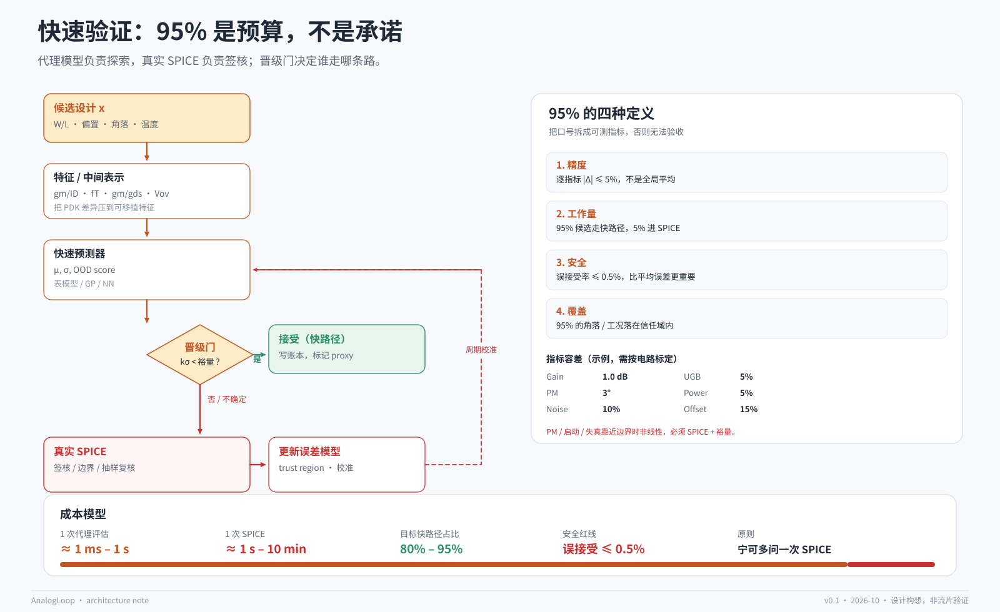

# 快速验证：95% 是预算，不是承诺

## 1. 问题

模拟电路的内环是“改参数 → 跑仿真 → 看指标”。如果 agent 的每一次思考都对应一次 SPICE，那么 agent 只是把人的手速换成了 API 调用，内环仍然被仿真器锁死。

要真正加速，必须让**大多数候选**在一个比 SPICE 快几个数量级的评估器上完成筛选，只把少量候选送进 SPICE 签核。这就是“两层验证”。

但这里有一个危险的诱惑：把代理模型的平均精度当成通行证。**平均精度不是安全指标。** 一个平均误差 2% 的代理，可能在 spec 边界上有 20% 的误接受；而签核只关心边界。

所以本文的核心不是“如何训练一个更准的代理”，而是“**如何让一个不完美的代理可以安全地参与决策**”。

## 2. “95%”的两种含义

“95%”至少可以指两件不同的事，必须分开写：

| 说法 | 含义 | 度量 |
|---|---|---|
| 精度 95% | 逐指标相对误差 ≤ 5% | `abs(pred - spice) / abs(spice)` 的分布 |
| 工作量 95% | 95% 的候选由快路径处理 | `fast_calls / (fast_calls + spice_calls)` |

两者不能互相替代。一个精度 99% 但只覆盖 10% 候选的代理，对吞吐帮助有限；一个覆盖 95% 但误接受率 5% 的代理，会制造灾难。

本仓库建议同时报告四个数：

1. **精度**：逐指标误差的中位数、p95、最大值；
2. **工作量**：快路径占比；
3. **安全**：误接受率（false accept rate）；
4. **覆盖**：OOD 比例、角落覆盖率。

## 3. 三个层级的代理

“把 PDK 压成数据库”不是一个单一动作。按抽象层级，至少有三层：

### L0：gm/ID 表（物理启发的中间表示）

把器件偏置写成 `(gm/ID, L, Vds, Vbs, T)` 的函数，存 `gm, gds, fT, Id/W, Vov, Cgg` 等。

- 优点：可移植、可解释、数据量小、跨 PDK 只需重跑表征；
- 缺点：仍要 SPICE 生成表；对失配、噪声、大信号、寄生的覆盖有限；
- 适合：早期 sizing、跨工艺探索、给学习型代理提供特征。

公开工具：[Mosplot / gmid](https://github.com/medwatt/gmid)、[pygmid](https://github.com/dreoilin/pygmid)、[gmoverid-skill](https://github.com/Arcadia-1/gmoverid-skill)。

### L1：器件级代理（device-level surrogate）

学习 `I_D(Vgs, Vds, Vbs, W, L, T)`、`Q(V)`、噪声、失配，替代 BSIM4 的求值。

- 优点：比 L0 更通用，可覆盖高维、非单调区域；可微，适合梯度/BO；
- 缺点：需要训练数据；必须保证导数连续与单调性；角落要单独建模；
- 关键：只有器件模型还不够，**还需要一个求解器**（MNA/Newton）才能得到电路指标。

“大表”本身不是仿真器。表是器件模型，仿真器是求解器；两者要分开设计。

### L2：电路级代理（circuit-level surrogate）

直接从 sizing 预测电路指标，例如 `Gain, UGB, PM, Power`。

- 优点：最快，适合海量筛选；
- 缺点：泛化最窄；换拓扑、换角落、换负载就可能失效；
- 适合：固定拓扑内、训练分布内的排序与筛选，不适合签核。

### 推荐组合

**L0 特征 + L2 快速打分 + L1/SPICE 兜底。** gm/ID 提供物理上可移植的坐标，L2 提供速度，SPICE 提供真值。L1 是长期投入，先不做也能跑通闭环。

## 4. 晋级门

晋级门是两层验证的核心。它不追求“判断代理准不准”，而是判断“**这条 case 能不能安全地只信代理**”。

输入：

- 代理预测 `mu` 与不确定度 `sigma`；
- 到 spec 的裕量 `margin`；
- OOD 分数；
- case 的关键程度（PM、启动、失真等高风险指标加权）；
- 剩余预算。

规则示例：

~~~text
if ood_score > ood_threshold:            -> SPICE
elif sigma * k > margin:                 -> SPICE
elif criticality == "signoff":           -> SPICE
elif budget_spice_remaining > reserve:   -> SPICE (stratified sample)
else:                                    -> accept (fast)
~~~

两个细节：

- **保守方向**：宁可多问一次 SPICE。快路径的价值是吞吐，不是省到最后一毫秒。
- **抽样复核**：即使接受快路径，也按分层抽样（边界、高 sigma、随机）周期性跑 SPICE，用于校准。

## 5. 误接受率比平均误差重要

定义（在边界附近，或在整个候选集上）：

- **误接受（false accept, FA）**：代理说满足 spec，SPICE 说不满足；
- **误拒绝（false reject, FR）**：代理说不满足，SPICE 说满足。

签核最怕 FA。一个 FA 会把“看起来收敛”的设计带进最终报告，甚至带进流片。

建议报告：

- `FAR = FA / (FA + TN)`（边界样本上的误接受率）；
- `FFR = FR / (FR + TP)`（误拒绝率，影响效率但不直接影响正确性）；
- 在**距离 spec 边界 5%、10%、20% 的三个带上**分别报告，而不是只报全局。

目标：边界 10% 带内 `FAR ≤ 0.5%`。这个目标是否可达，取决于电路、指标、代理和校准，必须实测。

## 6. 校准环

代理不是一次性训练完就固定。它需要像 cache 一样被“一致性协议”维护。

### 6.1 成对采样

每隔 `N` 次快评估，抽 `m` 条候选同时跑 SPICE：

- 边界样本：|margin| 小；
- 高不确定度样本：sigma 大；
- 随机样本：监控整体漂移；
- 角落样本：SS/FF、极端温度。

### 6.2 误差模型

不要只存一个全局 RMSE。按指标、角落、区域存残差分布：

~~~text
error[metric][corner][region] = {median, p95, max, n}
~~~

这个误差模型反过来喂给晋级门：sigma 不是模型自带的自信，而是**历史残差**。

### 6.3 信任域

判断候选是否在训练分布内：

- 参数空间的凸包 / 密度估计；
- Mahalanobis 距离；
- 模型集成的不一致度；
- 最近邻距离。

任一超阈值，就降级到 SPICE。

### 6.4 漂移检测

代理、仿真器、PDK 版本一变，历史误差可能失效。用固定回归集做“冒烟测试”：

- 每次升级跑 20–50 条固定 case；
- 误差分布显著偏移 → 冻结代理，重新校准。

## 7. 成本模型

设快评估成本 `t_f`，SPICE 成本 `t_s`，快路径比例 `r`。忽略误接受时：

$$
S = \frac{t_s}{r \cdot t_f + (1-r)\cdot t_s}
$$

若 `t_f = 0.001 t_s`、`r = 0.95`，则 `S ≈ 19.6`。这就是“95% 快路径”的吸引力。

但误接受不是免费的。加上返工成本 `c_fail`：

$$
E[\text{cost}] = N \cdot [r t_f + (1-r) t_s + FAR \cdot c_{\text{fail}}]
$$

当 `c_fail` 很大（例如错过签核、重新设计、流片失败），最优 `r` 会显著低于 0.95。**代理的价值不是把 r 推到 1，而是把 r 推到一个风险可接受的最优点。**

## 8. 评测协议

详细版见 [benchmark-protocol.md](benchmark-protocol.md)。最小要求：

1. **按拓扑/角落分组划分**训练/测试，不随机打散；
2. 报告误差分布（median、p95、max），不只报 mean；
3. 报告边界带上的 FA/FR；
4. 报告 wall-clock 加速，包含代理推理、I/O、排队；
5. 报告 OOD 检测的 ROC / AUROC；
6. 报告校准曲线（预测区间 vs 实际覆盖率）；
7. 固定随机种子与仿真器版本。

## 9. 失败模式

| 失败 | 原因 | 对策 |
|---|---|---|
| 外推 | 候选跑出训练分布 | OOD + 强制 SPICE |
| 角落盲 | 只学 TT | 角落作为输入 + 分层采样 |
| 瞬态失真 | 代理只学 DC/AC | 波形级特征 + SPICE 复核 |
| 失配/噪声 | 统计量被当成确定量 | 输出分布 + MC 抽样 |
| 指标刷分 | 测量定义不一致 | measurement contract + 多指标门 |
| 数据泄漏 | 同一设计跨 split | group split + 哈希去重 |
| 版本漂移 | 仿真器/PDK 升级 | 回归集 + 冻结/重校准 |

## 10. 与现有工作的关系

- **LASANA**（MLCAD 2025）用 ML 代理替代模拟子块仿真，报告最高三个数量级加速，能量/延迟/行为误差分别 < 7%、< 8%、< 2%。这说明“95% 量级”的目标在子块层面是现实的。
- **Table-based device modeling**（Berkeley）早已证明查表 + 插值可以用于电路仿真，但需要处理平滑性、导数和参数可访问性。
- **Neural compact models** 把网络嵌入 SPICE，走的是“器件级加速”路线，而不是“电路级替代”。
- **Cyber Wolf**、**Opera** 等工作把图表示、代理模型和 sizing 流程结合，说明“快速评估 + 优化”已是活跃方向。
- **gm/ID 工具链**（Mosplot、pygmid）提供了可移植的 L0 表示，且已经在开源 PDK 上可用。

本仓库的增量不是“发明代理模型”，而是：

1. 把代理明确放在**晋级门**后面，而不是默认替代 SPICE；
2. 把**误接受率**作为一等指标；
3. 把校准、信任域、版本漂移写成可执行的协议；
4. 把“预算”与“快慢路径”绑定成一个控制器。

## 11. 结论

- 代理模型是仿真器的 **cache**，不是替代品。
- 95% 是**预算**，不是承诺；它必须被拆成精度、工作量、安全、覆盖四个指标。
- 真正决定成败的不是平均误差，而是**边界上的误接受率**。
- 晋级门、校准环、信任域、版本回归，四者缺一不可。

如果这四件事做好，代理可以承担 80–95% 的探索；如果做不好，代理越准，越危险。
