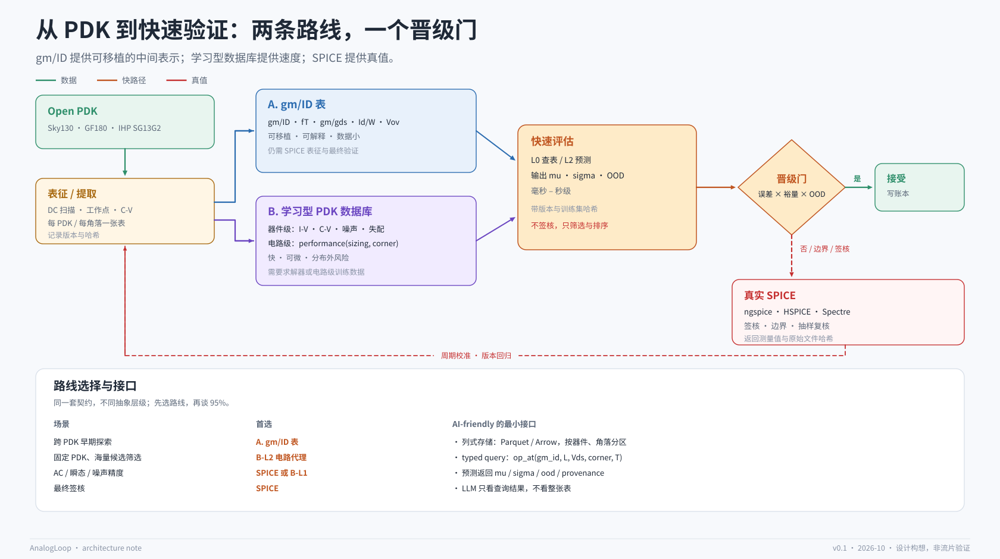

# gm/ID 与学习型 PDK 数据库

> 这一页讨论两条“快速验证”路线：A. gm/ID 表；B. 把 PDK 压成 AI 可用的数据库。
> 结论先写在前面：**两条路线不是替代关系，而是不同抽象层级。**

## 1. 两条路线

| | A. gm/ID 表 | B. 学习型 PDK 数据库 |
|---|---|---|
| 抽象层级 | 器件偏置的归一化坐标 | 器件级 I-V/C-V/噪声/失配，或电路级性能 |
| 数据来源 | DC 扫描 + 工作点参数 | PDK/TCAD/SPICE 生成的数据 |
| 输出 | gm/ID、fT、gm/gds、Id/W、Vov | 电流、电荷、电容、噪声、失配、指标预测 |
| 速度 | 查表 + 插值，快 | 网络/表求值，更快 |
| 可移植 | 高（换 PDK 重跑表征） | 低（每个 PDK 单独训练） |
| 可解释 | 高 | 中（取决于模型） |
| 主要风险 | 二阶效应、失配、噪声覆盖不足 | 分布外、角落遗漏、导数不连续 |

## 2. 路线 A：gm/ID 表

### 2.1 原理

gm/ID 把 MOS 的偏置状态压到一个无量纲坐标：

- `gm/ID`：跨导效率，决定“每单位电流能换多少 gm”；
- `fT`：速度能力；
- `gm/gds`：本征增益；
- `Id/W`：电流密度；
- `Vov`：过驱动电压（近似）。

在同一个 `gm/ID` 下，不同 L、不同 PDK 的 `fT`、`gm/gds`、`Id/W` 可以画成设计图。设计者先选 `gm/ID`（噪声/速度/摆幅的折中），再选 L，再算 W 和偏置。

### 2.2 提取

一次表征通常包含：

1. 固定 `Vds`、`Vbs`、温度、角落；
2. 扫描 `Vgs` 与 L；
3. 记录 `Id, gm, gds, Cgg, Cgd, Cdb, fT, Vth` 等；
4. 存成每个 PDK / 每个角落一张表；
5. 用插值查询任意偏置点。

公开工具已经把这套流程工程化：

- [Mosplot / gmid](https://github.com/medwatt/gmid)：lookup table、设计图、多角落自动 sizing，最后写网表交给仿真器验证；
- [pygmid](https://github.com/dreoilin/pygmid)：Murmann gm/ID starter kit 的 Python 版；
- [gmoverid-skill](https://github.com/Arcadia-1/gmoverid-skill)：把 gm/ID 表征与 Sky130 流程封装成 agent skill；
- [opensrc_gmid](https://github.com/eescottie/opensrc_gmid)：IHP SG13G2 + ngspice 的开源流程。

### 2.3 优点

- **可移植**：设计直觉和流程跨 PDK 复用；换工艺只需重跑表征。
- **可解释**：每个选择都能回到“为什么这个 gm/ID、这个 L”。
- **数据小**：一张表覆盖一个器件/角落，适合放进仓库。
- **物理约束强**：不容易给出违反平方律/EKV 趋势的荒谬解。

### 2.4 缺点

- **仍要 SPICE**：表征本身要跑 DC 扫描；最终验证也要 SPICE。
- **二阶效应**：短沟道、速度饱和、DIBL、GIDL、自热，表格能覆盖但外推危险。
- **失配/噪声**：gm/ID 表通常不含统计失配和噪声；需要额外的 Pelgrom/噪声模型。
- **大信号**：摆幅、压摆率、失真、启动，gm/ID 只能给一阶估计。
- **寄生**：高频下的 Cgd、Cdb、Rgate 需要额外数据。

所以路线 A 的定位是：**早期 sizing 和跨 PDK 探索**，不是签核。

## 3. 路线 B：学习型 PDK 数据库

### 3.1 它到底是什么

“把 PDK 压成一个大表”可以有两种完全不同的实现：

1. **器件级**：学习 `I_D(Vgs,Vds,Vbs,W,L,T)`、`Q(V)`、噪声、失配，替代 BSIM4 的求值；
2. **电路级**：学习 `performance(sizing, corner)`，直接预测 Gain/UGB/PM/Power。

前者需要一个求解器才能算电路；后者不需要求解器，但泛化最窄。两者都不是“把 CSV 丢给 LLM”。

### 3.2 器件级数据契约

一个 AI/工具友好的器件库，至少要有：

~~~yaml
device: sky130_fd_pr__nfet_01v8
corner: tt
temperature_k: 300
geometry: {w_um: 1.0, l_um: 0.15, nf: 1}
bias: {vgs_v: 0.70, vds_v: 0.60, vbs_v: 0.0}
dc: {id_a: 1.2e-4, gm_s: 1.1e-3, gds_s: 2.0e-5, vth_v: 0.45}
cap: {cgg_f: 8.0e-15, cgd_f: 1.2e-15, cdb_f: 0.9e-15}
noise: {thermal_a2_hz: 1.0e-22, flicker_a2_hz_at_1hz: 3.0e-21}
mismatch: {avt_mv_um: 5.0, abeta_pct_um: 1.0}
provenance: {simulator: ngspice-44, model: sky130_tt, netlist_sha256: "..."}
~~~

关键不是字段多，而是：

- **导数**：`gm = dId/dVgs`、`gds = dId/dVds` 必须由模型给出，且连续；
- **平滑**：插值不能产生毛刺，否则 Newton 不收敛；
- **单调/物理约束**：`Id` 随 `Vgs` 单调、电容对称性、噪声非负；
- **不确定度**：每个预测带 `sigma` 或置信区间；
- **角落维度**：角落不是插值出来的，是离散的；
- **版本与哈希**：否则无法重放。

### 3.3 电路级数据契约

如果做 L2 代理，输入是 sizing 向量 + 角落 + 温度，输出是指标分布：

~~~yaml
topology: two-stage-opamp-v1
sizing: {w1_um: 20, l1_um: 0.5, w5_um: 40, ...}
corner: ss
temperature_c: 125
prediction:
  gain_db: {mu: 62.0, sigma: 0.8}
  ugb_mhz: {mu: 105.0, sigma: 4.0}
  pm_deg: {mu: 61.0, sigma: 2.5}
  power_mw: {mu: 4.8, sigma: 0.15}
ood_score: 0.07
provenance: {model_sha256: "...", train_set_sha256: "..."}
~~~

### 3.4 优点

- 比 SPICE 快几个数量级；
- 可微，适合梯度/BO；
- 可以覆盖高维、非单调区域；
- 一旦建成，跨项目复用。

### 3.5 代价

- 需要大量高质量训练数据；
- 角落、温度、失配要单独覆盖；
- 外推风险高；
- 导数不连续会让求解器崩；
- 商业 PDK 数据不能公开，开源仓库只能用 open PDK。

## 4. 混合路线：gm/ID 特征 + 学习型残差

最现实的组合不是二选一，而是：

1. 用 gm/ID 表得到一阶设计点与物理特征；
2. 用学习型模型预测“相对 gm/ID 基线的残差”；
3. 用 SPICE 校准残差；
4. 用晋级门决定何时相信残差。

好处：

- gm/ID 提供外推时的物理骨架，降低网络在分布外的荒谬输出；
- 残差学习只需要学“二阶修正”，数据需求更小；
- 特征可解释，失败可诊断。

这与“few-shot GNN + gm/ID”这类工作的思路一致：把物理方法作为先验，把学习作为修正。

## 5. “AI-friendly”不等于“prompt-friendly”

一个常见的误解是：把大表塞进 LLM 上下文，模型就能“理解 PDK”。

实际上：

- LLM 不擅长数值插值，容易编造；
- 大表会迅速耗尽上下文；
- 表里的数值没有版本、没有不确定度，无法审计。

正确的做法是**工具友好**：

- 数据存成列式格式（Parquet/Arrow），按器件、角落、几何分区；
- 暴露 typed query API，例如：

~~~text
device.op_at(gm_id=12, L=0.5, Vds=0.6, corner="ss", T=125)
device.iv_sweep(vgs=[0.4..0.9], vds=0.6, W=10, L=0.5)
predict.topology("two-stage-opamp-v1", sizing, corner="ff")
~~~

- LLM 只看到“查询结果 + 不确定度 + 版本”，不看到整张表；
- 所有查询走工具契约，可缓存、可限流、可审计。

**AI-friendly 的是接口和 schema，不是把数据倒进 prompt。**

## 6. 开源 PDK 与 NDA

公开仓库只能用允许再分发的 PDK：

- [SkyWater Sky130](https://github.com/google/skywater-pdk)（Apache-2.0）；
- [GF180MCU](https://github.com/google/gf180mcu-pdk)（Apache-2.0）；
- [IHP SG13G2](https://github.com/IHP-GmbH/IHP-Open-PDK)。

商业 PDK 的模型、参数、提取表通常受 NDA 约束，不能进入公开仓库。这也意味着：

- 公开 demo 只能用 open PDK；
- 商业 PDK 的实验只能报告方法，不能报告数据；
- “跨 PDK 可移植”最好用两个 open PDK 证明（例如 Sky130 + GF180）。

## 7. 决策矩阵

| 场景 | 首选 | 原因 |
|---|---|---|
| 跨 PDK 早期探索 | A（gm/ID） | 可移植、可解释、数据小 |
| 固定 PDK、海量候选筛选 | B-L2（电路代理） | 最快 |
| 需要 AC/瞬态/噪声精度 | SPICE 或 B-L1 | 代理覆盖不足 |
| 靠近 spec 边界 | SPICE | 误接受风险 |
| 最终签核 | SPICE | 唯一真值 |
| 给 LLM 做策略提示 | A + 账本摘要 | 不要把大表放进上下文 |

## 8. 开放问题

1. 角落应该作为模型输入，还是每个角落单独建模？
2. 如何保证表模型/网络的导数连续，且不破坏 Newton 收敛？
3. 失配是确定量还是分布？如何在不跑 MC 的情况下给出台阶？
4. 跨 PDK 的归一化特征，哪些真的可迁移，哪些只是巧合？
5. 多少数据才够？主动学习能否把表征成本降到可接受？
6. 商业 PDK 场景下，如何在不泄露数据的前提下做可复现研究？

这些问题没有标准答案，但它们是这个仓库后续实验的核心。
