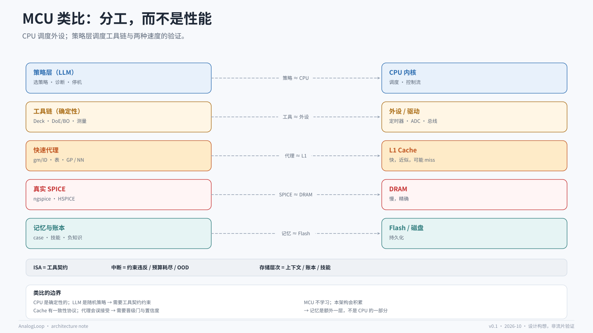

# MCU 类比：分工，而不是性能

## 为什么用这个类比

模拟设计工程师对 MCU 的“CPU + 外设 + 存储”分工非常熟悉。把 agent 架构映射到这个分工上，可以用一分钟讲清楚三件事：

1. 为什么 LLM 不应该直接操作网表；
2. 为什么工具链要确定性；
3. 为什么代理模型和记忆是两件不同的事。

这个类比是**沟通工具**，不是技术论证。它能帮助听众建立直觉，但不能证明架构正确。

## 映射表

| AI 仿真优化系统 | MCU 架构 | 共同点 | 差异 |
|---|---|---|---|
| 策略层（LLM） | CPU 内核 | 决定下一步做什么 | CPU 确定性；LLM 随机、会幻觉 |
| 工具链 | 外设 / 驱动 | 把意图变成具体动作 | 外设行为固定；工具可版本升级 |
| 快速代理 | L1 Cache | 快、近似、可能 miss | Cache 有一致性协议；代理没有 |
| 真实 SPICE | DRAM | 慢、精确、最终真值 | DRAM 不会“算错”；SPICE 有收敛/模型误差 |
| 记忆与账本 | Flash / 磁盘 | 持久化、可恢复 | Flash 不学习；账本可以积累知识 |
| 预算控制器 | 调度器 / 功耗管理 | 分配有限资源 | 这里的资源是仿真次数 |
| 晋级门 | Cache 控制器 / MMU | 决定命中还是回退 | 这里的“miss”代价是仿真时间 |

## ISA = 工具契约

CPU 的指令集是软件与硬件之间的契约：有限、typed、可验证。Agent 也需要这样一套契约：

- `set_spec`：写入目标与约束；
- `get_role_map`：读取紧凑角色视图；
- `propose_candidate`：提出候选与理由；
- `validate_roles`：校验角色声明与拓扑；
- `apply_role_patch`：角色级修改；
- `evaluate_fast`：请求快速评估；
- `estimate_area`：估算 pre-layout 面积；
- `simulate_spice`：请求真值；
- `measure`：按固定定义读取指标；
- `commit_case`：写账本；
- `query_memory`：查询历史；
- `export_layout_intent`：输出 floorplan / delta；
- `stop`：结束并给出理由。

完整定义见 [tool-contract.md](tool-contract.md) 与 [../spec/tool-contract.yaml](../spec/tool-contract.yaml)。

ISA 的三个性质同样适用：

1. **有限**：工具数量可控，LLM 不需要“发明”新操作；
2. **typed**：参数和返回值有 schema，非法调用在执行前被拒绝；
3. **可验证**：每次调用都有成本、副作用、版本。

## 中断 = 需要策略层注意的事件

MCU 用中断处理“计划外但重要”的事件。Agent 也需要：

| 中断 | 触发 | 处理 |
|---|---|---|
| 约束违反 | 候选越界 / 不可行 | 记录负知识，回退 |
| 预算耗尽 | 剩余仿真次数不足 | 强制进入确认阶段或停止 |
| OOD | 候选跑出信任域 | 强制 SPICE |
| 收敛停滞 | 连续 N 次无改进 | 换策略或停止 |
| 仿真失败 | 不收敛 / 语法错误 | 诊断 deck，重试上限 |
| 指标冲突 | 多目标无法同时满足 | 返回 Pareto 前沿，交给人 |

中断不应该直接修改目标；它应该先进入账本，再由策略层或人决定。

## 存储层次 = 三种记忆

| 层次 | 内容 | 生命周期 | 访问方式 |
|---|---|---|---|
| L1 上下文 | 当前 spec、最优解、最近失败、预算 | 单轮 | 受控视图 |
| L2 账本 | 所有 case 的事实记录 | 项目级 | 查询 / 重放 |
| L3 技能 | 规则、playbook、负知识 | 跨项目 | 检索 / 提示 |
| “Cache” | 代理模型 | 版本级 | 预测 + 校准 |

关键原则：**L1 只放摘要，L2 放事实，L3 放可错的经验。** 不要把三者混在一个向量库里。

## 类比的边界

这个类比在三个地方会失效：

1. **确定性**：CPU 执行一条指令的结果是确定的；LLM 的策略是随机的。所以需要工具契约、温度控制、种子和重放。
2. **一致性**：Cache 有一致性协议，代理没有。代理会“自信地错”，所以需要晋级门、误接受率和校准。
3. **学习**：MCU 不会从任务中学习；本架构会积累技能和负知识。记忆是额外一层，不是 CPU 的一部分。

承认这三条，类比才有用；否则它会给人“系统已经像 CPU 一样可靠”的错觉。

## 一句话总结

**CPU 调度外设完成任务；策略层调度工具链与两种速度的验证完成设计优化。** 类比的是分工，不是性能，也不是可靠性。