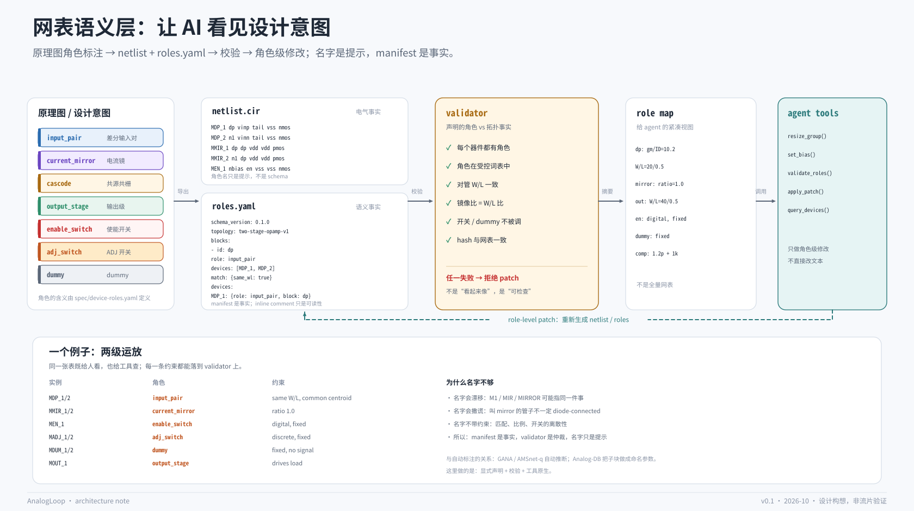

# 网表语义层：让 AI 看见设计意图



## 1. 问题：netlist 是扁平的

一条 SPICE 网表长这样：

```text
M1 d g s b nmos W=20u L=0.5u
```

它告诉工具“有一个 MOS，接在这四个节点上”，但没有告诉 AI：

- 它是差分输入对的一侧，还是电流镜的一侧？
- 它必须和谁保持相同的 W/L？
- 它的栅极是不是接在偏置网上？
- 它是 dummy、使能开关，还是可调的 ADJ 开关？
- 它到底能不能被改？

人类工程师靠原理图、命名习惯和上下文补上这些信息。LLM 没有这些上下文，于是只能猜；猜错就会：

- 只改差分对的一侧，破坏匹配；
- 改电流镜的一侧，改变比例；
- 动 dummy 或使能管，引入无意义的变量；
- 把数字开关当模拟偏置去“优化”；
- 在报告里说“调整了 M3”，但没人知道 M3 是什么。

所以问题不是“AI 会不会写网表”，而是“**AI 能不能看见网表里的设计意图**”。

## 2. 主张：加一层“语义网表”

建议在原理图/网表之间加一层**显式的角色标注**：

| 产物 | 回答的问题 | 谁维护 |
|---|---|---|
| `netlist.cir` | 电路在电气上是什么 | 仿真器 / 导出工具 |
| `roles.yaml` | 每个器件在设计中扮演什么角色 | 设计师声明，工具校验 |
| `role map` | 给 agent 的紧凑视图 | 工具生成 |
| `device-roles.yaml` | 角色词表与约束 | 仓库维护 |
| validator | 声明是否与拓扑一致 | 工具执行 |
| role-aware tools | 如何安全地改 | 工具链提供 |

一句话：

> **名字是提示，manifest 是事实，validator 是仲裁。**

这不是“让命名更规范”的代码风格问题，而是把设计意图变成**可检查、可版本化、可被工具调用的接口**。

## 3. 为什么“名字”本身不够

只靠命名约定，会遇到四个问题：

1. **会漂移**：M1、M2、MIR、MIRROR、DP1 可能指同一件事，也可能不是。
2. **会撒谎**：叫 `MMIR_2` 的管子不一定 diode-connected；叫 `MCAS_1` 的管子不一定在 cascode 位置。
3. **不带约束**：名字无法表达“MDP_1 和 MDP_2 必须同 W/L、同方向、一起移动”。
4. **不适合层级/多 finger**：一个“角色”可能对应一个 group、多个 finger、多个并联单元，而不是单个实例。

所以名字可以保留，用于人读；但**机器判断必须依赖 manifest + validator**。

## 4. 为什么“自动推断”也不够

自动标注已经有成熟工作：

- **GANA**（DATE 2020）用图卷积网络把模拟网表标注成功能块；
- **AMSnet-q**（2026）从原理图自动提取网表并做功能/性能标注；
- **AgenticSizing**（2026）把网表分解成功能块和子结构，再交给多智能体 sizing。

这些工作证明“功能结构对 AI 有用”，但也说明：

- 推断会错，而且错得安静；
- 推断结果依赖模型和训练分布；
- 推断无法替代设计师的意图（例如“这个管子是 dummy，不要动”）；
- 没有版本化的“声明”，就无法审计“AI 为什么改了它”。

更稳的做法是：

1. 用推断给 legacy 网表做**冷启动**；
2. 人工审核关键 group；
3. 冻结成 `roles.yaml`；
4. 之后所有修改都走 manifest + validator；
5. 推断与声明不一致时，以声明为准，并记录分歧。

## 5. 角色词表

完整词表在 [../spec/device-roles.yaml](../spec/device-roles.yaml)，目前 17 个角色。核心角色：

| 角色 | 典型器件 | 关键约束 | 可调 |
|---|---|---|---|
| `input_pair` | 差分对 | 同 W/L、同方向、共质心优先 | 是 |
| `tail_source` | 尾电流源 | 饱和、余度 | 是 |
| `active_load` | 有源负载 | 饱和、余度 | 是 |
| `current_mirror` | 电流镜 | 比例 = W/L 比、参考管 diode-connected | 是 |
| `cascode` | 共源共栅 | 栅接偏置网、余度 | 是 |
| `output_stage` | 输出级 | 驱动负载、压摆 | 是 |
| `bias_reference` | 偏置基准 | 电流密度、饱和 | 否 |
| `enable_switch` | 使能开关 | 数字控制、关断漏电 | 否 |
| `adj_switch` | ADJ / 配置开关 | 数字、离散状态 | 否 |
| `dummy` | 匹配 dummy | 固定几何、无信号路径 | 否 |
| `compensation_cap` | 补偿电容 | 稳定性、面积 | 是 |
| `nulling_resistor` | 调零电阻 | 稳定性、工艺偏差 | 是 |
| `load_cap` | 负载电容 | 由系统固定 | 否 |

ESD、decap、startup、protection 也在词表里，但默认不进入 sizing 向量。

## 6. Manifest 长什么样

一个最小的 `roles.yaml`：

```yaml
schema_version: "0.1.0"
topology: two-stage-opamp-v1
netlist: netlist.cir
netlist_sha256: "sha256:..."

blocks:
  - id: dp
    role: input_pair
    devices: [MDP_1, MDP_2]
    match: {same_wl: true, same_orientation: true, common_centroid: preferred}
    tunable: true

  - id: mirror_load
    role: current_mirror
    devices: [MMIR_1, MMIR_2]
    match: {same_wl: true, same_orientation: true}
    ratio: 1.0
    tunable: true

  - id: en
    role: enable_switch
    devices: [MEN_1]
    tunable: false
    constraints: {digital: true}

devices:
  MDP_1: {role: input_pair, block: dp, model: nmos, tunable: true, criticality: signoff}
  MDP_2: {role: input_pair, block: dp, model: nmos, tunable: true, criticality: signoff}
```

为什么用 sidecar，而不是把角色写进网表注释？

- SPICE 注释不是结构化数据，不同仿真器/工具的保留行为不一致；
- 网表必须保持可被 ngspice/HSPICE/Spectre 直接读取；
- sidecar 可以独立版本化、哈希、校验；
- 内联注释可以保留，作为人读的提示，但不是事实来源。

落地方式：

- 在 Virtuoso / 原理图工具里给 instance 增加 `role` / `group` 属性，导出时生成 `roles.yaml`；
- 命名前缀（`MDP_`、`MMIR_`、`MCAS_`、`MEN_`、`MADJ_`、`MDUM_`、`MOUT_`）可以作为提示，但不能替代 manifest；
- legacy 网表用推断（GANA / AMSnet-q）冷启动，人工审核后冻结；
- 任何拓扑变更都要重新生成 manifest，角色不是永久的。

## 7. Validator 检查什么

[../scripts/validate.py](../scripts/validate.py) 目前实现了这些检查：

1. **覆盖**：网表里每个 M/C/R 器件，要么在 `devices` 里，要么在 `unannotated` 里显式排除；
2. **词表**：每个 `role` 必须在 `spec/device-roles.yaml` 中；
3. **分组**：每个器件只属于一个 block；block 的 role 与 device 的 role 一致；
4. **匹配**：声明了 `same_wl` 的 group，网表里的 W/L 必须一致；
5. **比例**：`current_mirror` 的 `ratio` 必须与 W/L 比一致（容差 1%）；
6. **开关/dummy**：`enable_switch`、`adj_switch`、`dummy` 必须 `tunable: false`；开关必须声明 `digital: true`；
7. **完整性**：`netlist_sha256` 必须与网表文件一致。

失败时，工具链应该：

- 拒绝这次补丁；
- 不消耗 SPICE 预算；
- 把错误码写进 case 记录（例如 `MATCH_VIOLATION`、`MIRROR_RATIO_MISMATCH`、`ROLE_NOT_TUNABLE`）；
- 让策略层在**不运行仿真**的情况下修正。

这和 [fast-verification.md](fast-verification.md) 里的“晋级门”是同一个思想：**在花真钱之前，先做便宜的检查。**

## 8. Agent 怎么用

### 8.1 读取

策略层不读全量网表，而是读 `get_role_map` 的紧凑视图：

```text
dp: gm/ID=10.2, W/L=20/0.5
mirror_load: ratio=1.0
out: W/L=40/0.5
en: digital, fixed
dummy: fixed
comp: 1.2p + 1k
```

需要细节时，再调 `query_devices(role="input_pair")`。

### 8.2 修改

策略层不直接改文本，而是发角色级补丁：

```yaml
action: apply_role_patch
args:
  block: tail
  action: resize
  factor: 1.2
rationale: "Increase tail current 20% to raise UGB; keep input pair gm/ID."
```

工具链负责：

1. 把 role-level 意图翻译成具体的 W/L/M 变化；
2. 保持同组器件一起移动；
3. 重新生成网表与 `roles.yaml`；
4. 调 `validate_roles`；
5. 通过后，才允许 `simulate_spice`。

### 8.3 诊断

当 SPICE 结果不达标时，角色映射把“指标 → 可能原因”变成可执行的提示：

| 症状 | 优先检查的角色 |
|---|---|
| PM 低 | `compensation_cap`、`nulling_resistor`、`output_stage` |
| Gain 低 | `cascode`、`active_load`、`output_stage` |
| Offset 高 | `input_pair`、`dummy` |
| Power 高 | `tail_source`、`output_stage`、`bias_reference` |
| Slew 低 | `tail_source`、`output_stage`、`compensation_cap` |
| 启动失败 | `startup`、`bias_reference`、`enable_switch` |

这不是硬编码的“专家系统”，而是把角色作为**检索键**：策略层可以据此选择下一步实验，也可以从记忆里取同角色的历史案例。

## 9. 与现有工作的关系

- **GANA**（DATE 2020）：GCN 自动标注功能块。证明“功能结构”有价值，但它是推断。
- **AgenticSizing**（2026）：把网表分解成功能块，再交给多智能体 sizing。证明 agent 需要功能结构。
- **Analog-DB**（2026）：把设计表示为 process-neutral topology、testbench、datasheet；把功能子块和器件尺寸做成**带匹配约束的命名参数**，供 AI agent 发现和复用。这是最接近“语义层”的工作。
- **AMSnet-q**（2026）：从原理图自动提取网表、生成测试台、用仿真验证功能，再打标签。
- **Semantic technology reasoning**（2022）：用本体描述电路功能组件。

本仓库的增量不是“第一次给器件起角色名”，而是：

1. 把角色作为**设计师声明**，而不是模型推断；
2. 用 **sidecar + schema + validator** 让声明可检查；
3. 把角色暴露成 **agent 可调用的工具**；
4. 把 `role_map_sha256` 写进 case 记录，支持重放。

## 10. 局限

- **名字会撒谎**：所以 manifest 是事实，validator 是仲裁；不要只信字符串。
- **维护成本**：设计师要维护 `roles.yaml`；用推断冷启动 + 人工审核可以降低。
- **层级与多 finger**：角色可能作用于 group、array、multi-finger；需要 `nf`、`m`、`unit_count` 等字段。
- **PDK 可移植**：角色是 PDK 无关的，但 model 名是 PDK 相关的；两者要分开。
- **Legacy 网表**：没有 manifest；先推断，再人工冻结。
- **Schema 漂移**：角色词表要版本化；新增角色要更新 validator 和文档。
- **推断准确率**：自动标注仍有误差；声明与推断的分歧要记录，不能静默覆盖。
- **一个器件可能有多个功能**（例如 current mirror 同时是 active load）：manifest 只设一个**主角色**，次要功能用 group / constraints 表达，避免多角色歧义。

### 未来扩展

- **net roles**：bias / signal / supply / ground，用于 ERC 和诊断；
- **port roles**：input / output / enable / trim；
- **group roles**：matched array、cascode stack、current mirror bank；
- **layout intent**：common centroid、symmetry、dummy ring（布局阶段，当前不做）。

设备角色是第一步；网表语义层最终应该覆盖 device / net / port / group 四类对象。

## 11. 可证伪假设 H4

**H4：与“只有命名约定”相比，manifest + validator + role-aware tools 能降低非法编辑率和修复所需的 SPICE 次数。**

可做的 ablation：

| 配置 | 说明 |
|---|---|
| A. 无角色 | 只给网表 |
| B. 只有名字 | 给命名约定，不给 manifest |
| C. manifest | 给 `roles.yaml`，但 agent 仍可直接改文本 |
| D. manifest + validator + tools | 本仓库方案 |

指标：

- 非法编辑率（匹配破坏、比例破坏、动 dummy/开关）；
- 达到 spec 所需 SPICE 次数；
- 修复成功率；
- 人工审核时间；
- 重放一致率。

当前状态：**未测**。这是 v0.2/v0.3 要验证的假设，不是已证结论。
